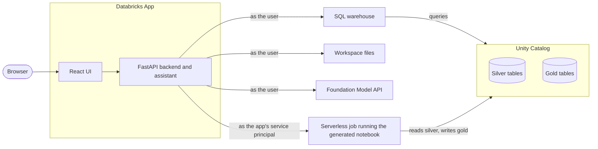

# Architecture

The app is a FastAPI backend with a React frontend, deployed as one Databricks App. It never
imports the framework itself: it turns a report definition into an Impulse notebook and runs that
notebook as a serverless job with a pinned Impulse release.

## Components

| Component | Role |
|---|---|
| Frontend (`frontend/`) | React and Vite: the report steps, the results charts and the chat window |
| Backend (`app.py`, `server/`) | FastAPI REST API; finds tables, units under test and channels through Unity Catalog and the SQL warehouse |
| Report definition | Data, units under test, signals, events and aggregations, checked against the framework rules as the user edits |
| Code generation | Turns the report definition into one Impulse notebook with the configuration, signals, events and aggregations |
| Runs | Pre-flight check of the user's and the service principal's access, then a serverless job that installs the pinned Impulse wheel |
| Results | Queries the report's gold tables with the user's permissions |
| Assistant | A Foundation Model API chat model with tools that do what the UI does, guided by app skills and the framework skills of the pinned version |

## Identities

- **The signed-in user.** Through Databricks Apps user authorization, every catalog, SQL,
  workspace and model call runs with the user's own permissions, so users only see data they can
  read.
- **The app's service principal.** Report jobs run as the service principal, which needs access to
  the silver and gold schemas. Before each run the app checks that both the user and the service
  principal can read the source tables and create tables in the output schema, and it shows the
  missing `GRANT` statements otherwise. The user gets `CAN_MANAGE_RUN` on their report's job.

## How a report runs

1. The report definition is saved in the user's workspace folder.
2. The app generates the notebook and runs the pre-flight check.
3. The notebook is published to the service principal's workspace folder, readable by the user.
4. A serverless job per user and report runs it, installing the Impulse wheel pinned by the app.
5. The job recomputes the selected recordings and overwrites the report's gold tables.
6. The app reads the gold tables back for the results charts.

## Where things are stored

| What | Where |
|---|---|
| Reports and their chat history | `/Users/<user>/Impulse/<report>/` |
| Each user's settings (SQL warehouse, chat model) | `/Users/<user>/Impulse/settings.json` |
| The shared data model | `/Workspace/Shared/Impulse/config.yaml` |
| Generated notebooks | `/Users/<service principal>/Impulse/<user>/<report>/report` |
| Report jobs | `Impulse <report> (<user>)`, tagged with the app, report, user and Impulse version |
| Results | Gold tables `<catalog>.<schema>.<table prefix>_*` in Unity Catalog (the prefix defaults to the report name), see [Gold Layer Schema](/docs/data_model/gold_layer_event_normalized) |

## Framework version

`impulse.lock` pins one Impulse release: the wheel that report jobs install, the serverless
environment version, and the framework skills the assistant reads. The app's tests check every
generated notebook against the same release.
