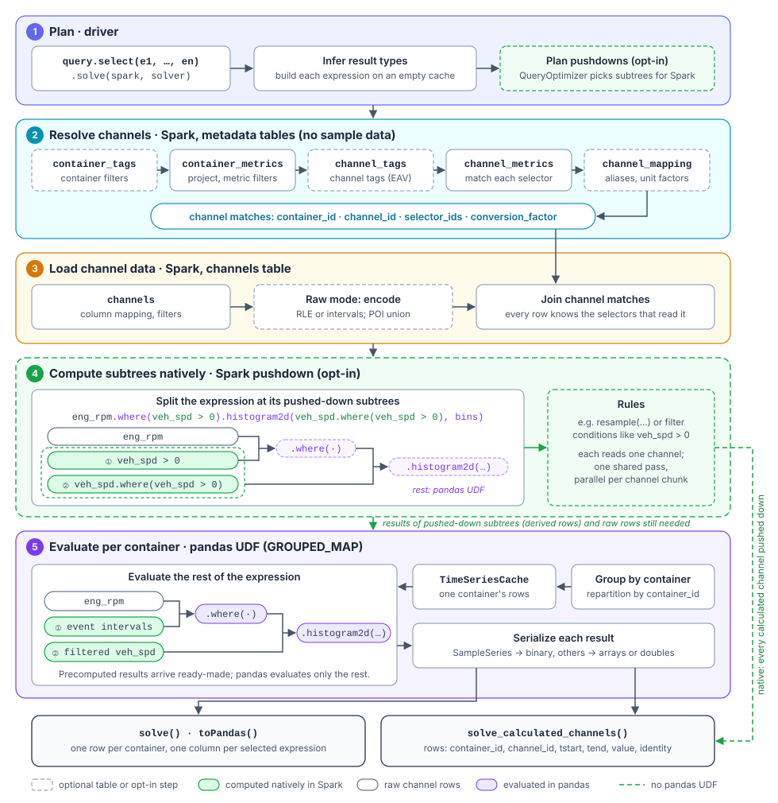

# How a Query Is Solved

One `solve()` call evaluates **every selected expression for every matching container**. The
expressions themselves are lazy ([Evaluation](tsal/evaluation.md)): nothing is computed until the
solver runs them through five stages. Query planning (stage 1) runs on the driver; query
execution (stages 2 to 5) runs in Spark. With [Spark pushdown](query_solvers.md#spark-pushdown-opt-in)
enabled, Spark computes supported subtrees natively in stage 4, and the pandas UDF in stage 5
consumes their results instead of evaluating them.



The example computes a 2D histogram of engine rpm and vehicle speed while the vehicle is
moving:

```python
eng_rpm = db.query.channel(channel_name="Engine RPM")
veh_spd = db.query.channel(channel_name="Vehicle Speed")
event = veh_spd > 0
result = db.query.select(
    eng_rpm.where(event)
    .histogram2d(veh_spd.where(event), [0, 1000, 2000, 3000, 4000], [0, 50, 100, 150, 200])
    .alias("rpm_vs_speed"),
).solve(spark, solver=DefaultSolver(spark, enable_pushdown=True))
```

## 1. Plan (driver)

- `select(...)` stores the expressions; `solve()` starts by **building each expression once
  against an empty cache**. This infers every result's type, and with it the schema of the output
  DataFrame, before any data is read (see
  [Planning: type inference before solve](tsal/evaluation.md#planning-type-inference-before-solve)).
  `solve_calculated_channels()` skips this step: its results are always sample rows.
- With pushdown enabled, the optimizer also picks the subtrees Spark computes natively in
  stage 4 (see stage 4 for the example).

## 2. Resolve channels (metadata tables)

The solver finds the physical channels each expression reads, using only the metadata tables. No
sample data is read in this stage. It covers the first five stages of the `QuerySolver` pipeline
(container tags, container metrics, channel tags, channel metrics, alias resolution); the sixth,
`solve`, covers stages 3 to 5 here.

1. **Containers.** `container_tags` (optional) and `container_metrics` select the containers of
   the configured project that match the query's container filters. Incremental report runs pass
   their pre-filtered containers here.
2. **Channels.** Every selector of every expression, e.g. `channel(channel_name="Engine RPM")`, is
   matched against the channel attributes on `channel_tags` (optional, EAV) or `channel_metrics`.
   A selector resolves to at most one channel per container, the one with the lowest `channel_id`
   (see [Channel selection](tsal/defining_expressions.md#channel-selection)).
3. **Aliases.** Alongside the direct selectors, selectors written with `channel_with_alias(...)`
   are resolved through `channel_mapping` (optional), by alias priority.
4. **Container metadata.** Container tags and metrics that expressions read are attached.

The result is a small table of channel matches: `container_id`, `channel_id` and the
`selector_ids` of the selectors that read the channel, plus the container metadata and, for
aliased channels, their source and target units.

## 3. Load channel data (Spark)

- The `channels` table is read with its column mapping and filters, keeping only `container_id`,
  `channel_id`, `tstart`, `tend` and `value`. Raw data is first encoded into RLE or interval
  samples; points-in-time data from `poi_channels` is added when an expression selects POI
  channels.
- Conversion factors for aliased channels are looked up in `unit_conversion` (optional).
- The samples are joined with the channel matches from stage 2, which keeps only the matched
  channels and attaches their selector ids, conversion factors and container metadata. With
  pushdown, the rows first carry only which results they feed; the rest is attached after
  stage 4.

## 4. Compute subtrees natively (Spark pushdown, opt-in)

Pushed-down subtrees are computed **in Spark, before any pandas code runs**, and only the rest of
each expression is left for the pandas UDF. The optimizer is rule-based: each rule computes one
kind of subtree on the rows of one channel, e.g. `resample(...)` or filter conditions such as
`veh_spd > 0`. All rules share the same reads of the channel data; rules that need a channel's
samples in order run in parallel per chunk of the channel (see
[How Spark runs pushed-down subtrees](query_solvers.md#how-spark-runs-pushed-down-subtrees)).

The example expression forms this tree (`event` is used twice, so it appears twice):

```
histogram2d(rpm_bins, speed_bins)          pandas UDF
├── where                                  pandas UDF
│   ├── eng_rpm                            raw rows
│   └── veh_spd > 0                        ① Spark: condition → Intervals
└── veh_spd.where(veh_spd > 0)             ② Spark: filter → SampleSeries
```

The optimizer cuts out a subtree when

1. **a rule matches it.** It takes the largest matching subtree: ② as a whole, not just the event
   inside it.
2. **it reads a single channel.** `eng_rpm.where(veh_spd > 0)` and `histogram2d` combine two
   channels and stay in pandas.
3. **every use of its channel is cut out.** All three uses of `veh_spd` lie in ① or ②, so its raw
   rows are no longer needed. `eng_rpm` is read by pandas directly, so its raw rows are shipped as
   before.

The results of cut-out subtrees are **derived rows** that replace the raw rows of their channel.
Here, instead of the full `veh_spd` channel, the UDF receives the event intervals ① (usually a few
rows) and the samples with `veh_spd > 0` ②. A channel can ship several derived results like this.

:::note Rules available today
The optimizer currently implements the `resample` rule; rules for further operations such as
filter conditions follow the same flow. Until a rule covers a subtree, it is evaluated in stage 5
as before.
:::

## 5. Evaluate per container (pandas UDF)

- The rows are **grouped by container**. Each container's rows reach one call of a pandas
  `GROUPED_MAP` UDF, so one task holds one container's rows in memory.
- A `TimeSeriesCache` serves the container's channels, its container tags and metrics, and the
  results of pushed-down subtrees.
- Each expression is **evaluated bottom-up, except for its pushed-down subtrees**: those arrive as
  finished results from stage 4. In the example, the UDF clips the raw `eng_rpm` rows to the
  precomputed event intervals ① and computes the 2D histogram against the precomputed `veh_spd`
  samples ②. Every other leaf loads its channel from the cache as a `SampleSeries` (or
  `PointsInTimeSeries` for POI channels), multiplied by the conversion factor for aliased
  selectors, and each operation then works on its children's results.
- Each result is encoded for the output. `solve()` serializes it into its column: `SampleSeries`
  as binary, `Intervals` and points as arrays, histograms as structs, scalars as doubles (see
  [From expression to result](tsal/evaluation.md#from-expression-to-result)).
  `solve_calculated_channels()` emits the samples of each calculated channel as rows.

## Results

| Call | Output |
|------|--------|
| `solve()` | One row per container, one column per selected expression, named by its alias. |
| `toPandas()` | The same, as a pandas DataFrame with `SampleSeries` objects deserialized. |
| `solve_calculated_channels()` | Silver-shaped rows `container_id, channel_id, tstart, tend, value` plus the channel's `identity`. |

When **every** calculated channel of a `solve_calculated_channels()` call is pushed down as a
whole, e.g. `CalculatedChannel(veh_spd.resample(1e6), {...})`, its rows come straight from stage 4
and no pandas UDF runs (see
[Calculated channels without the pandas UDF](query_solvers.md#calculated-channels-without-the-pandas-udf)).

:::note Where the work happens
Stages 2 to 4 are distributed Spark jobs; for rules that need samples in order, stage 4 even
splits each channel into chunks that run in parallel. Stage 5 runs in parallel across containers,
but each container is evaluated in a single task: the more channels and samples a container's
expressions read, the more memory that task needs. Every pushed-down subtree moves work from
stage 5 into stage 4 and usually reduces the rows that reach stage 5 (resampling to a finer rate
than the channel's own adds rows).
:::
